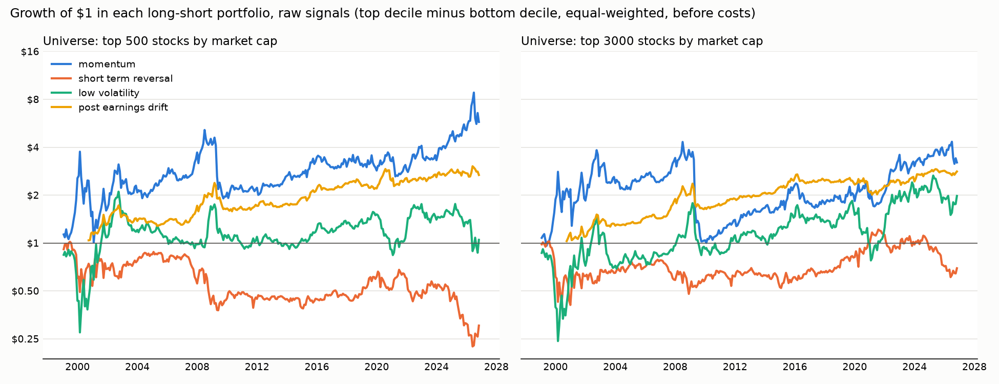
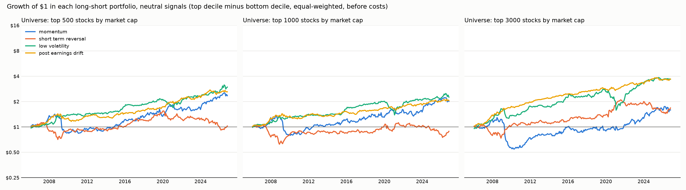
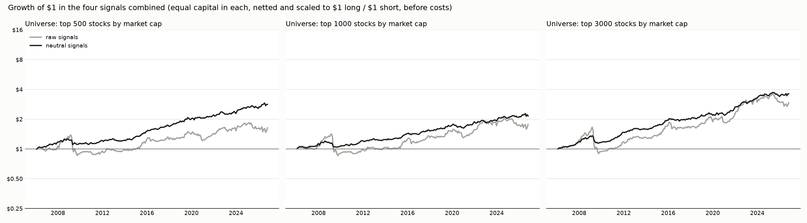
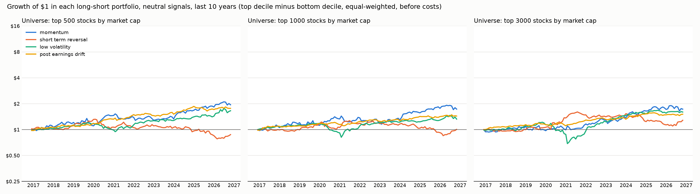
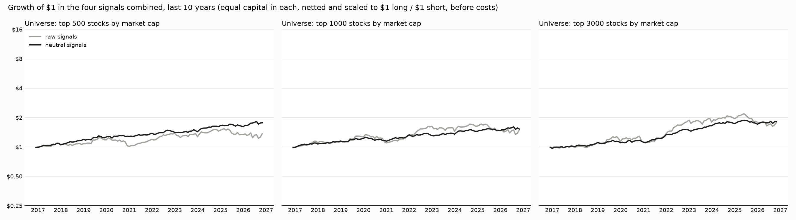
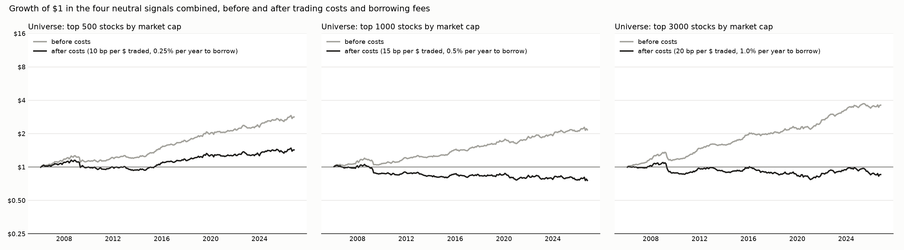
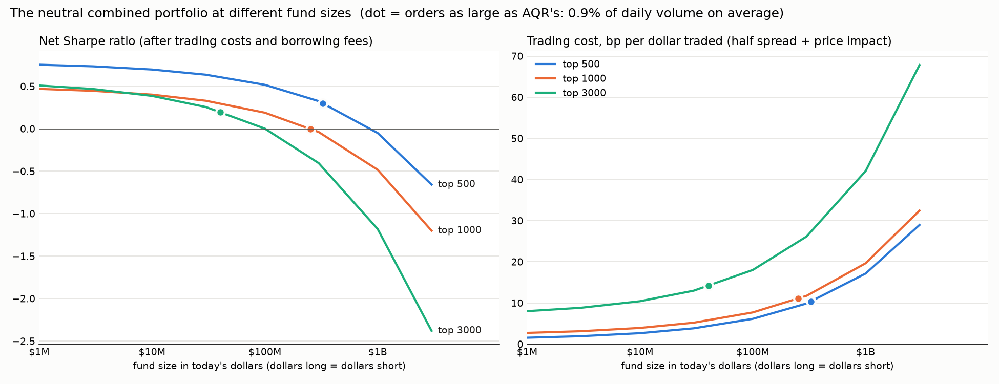

# Equity-Anomaly-Replication

Replication of four published cross-sectional anomalies in US equities, 2006 to 2026:
how much of their return is still there after publication.

Work in progress. Results are shown before and after trading costs and borrowing fees, with an
estimate of how large a fund can run the combined portfolio.

## Signals

| Signal | Paper | Score at month-end t |
|---|---|---|
| Momentum | Jegadeesh and Titman (1993) | return from t-12 to t-1, skipping the latest month |
| Short-term reversal | Jegadeesh (1990) | minus the return of month t |
| Low volatility | Ang, Hodrick, Xing and Zhang (2006) | minus the std of daily Fama-French three-factor residuals in month t |
| Post-earnings drift | Bernard and Thomas (1989) | latest standardized unexpected earnings (SUE), fading with age (see below) |

## Method

- **Universe**: at each month-end, US common stocks ranked by market cap, one share class per company,
  price of at least $1. Three versions: the largest 500, 1000 and 3000. Delisted stocks are included.
- **Portfolios**: sort the universe into 10 groups by score, hold each group for the next month with
  equal weights. Long-short = top group minus bottom group.
- **Neutral version**: each signal is also tested after removing its sector and market-beta part.
  At each month-end, inside each of 11 sectors, the score's rank is turned into a z-score and regressed on the
  stock's beta (252 trading days); the residual is the new score.
- **Post-earnings drift decays with age**: the surprise is multiplied by 0.5^(x / 20), x = calendar
  days from the announcement to the month-end (a half-life of 20 days), and a surprise older than
  90 days is not used. This is the only version tested; the paper's version, which keeps the full
  surprise for three months, is not.
- **Combined portfolio**: equal capital in four long-short portfolios (momentum, short-term
  reversal, low volatility, post-earnings drift), rebuilt every month. A stock that one
  signal buys and another shorts cancels, which leaves about $0.76 long and $0.76 short per $1;
  the holdings are then scaled back up to $1 long / $1 short.
- **t-stats**: two are reported. "t-stat" is mean / (std / sqrt(months)), which assumes the months
  are independent. "NW t-stat" (Newey and West 1987) allows for correlation between nearby months,
  with 4 lags (the usual rule floor(4 * (T / 100)^(2/9)) for 120 or 250 months) and linearly falling
  weights; see `newey_west_t_stat` in `portfolio.py`. The two are close everywhere here: the
  long-short returns have little autocorrelation (between -0.08 and 0.14 at lags 1 to 4 for the
  neutral top 3000 portfolios), even for post-earnings drift, whose surprise can stay in the portfolio for up to 90 days.
- **Costs**: every dollar traded costs 10 bp in the top 500, 15 bp in the top 1000 and 20 bp in the
  top 3000 (1 bp = 0.01%); borrowing the shorted stocks costs 0.25%, 0.5% and 1% per year.
  See "After transaction costs" below.
- **Data**: prices, market caps, fundamentals and 8-K dates from Sharadar; daily factors from the
  Ken French data library.

## Data range

Downloaded on 2026-11-15.

| Data | Source | First date | Last date |
|---|---|---|---|
| Daily prices | Sharadar | 1997-12-31 | 2026-11-13 |
| Daily market cap | Sharadar | 1998-12-01 | 2026-11-13 |
| Quarterly fundamentals | Sharadar | 1990-06 | 2026-11-13 |
| 8-K filings | Sharadar | 1993-11-08 | 2026-11-13 |
| Daily Fama-French factors | Ken French | 1926-07-01 | 2026-09-30 |

**Backtest period: holding months 2006-01 to 2026-10** (250 months, `SAMPLE_START` and
`SAMPLE_END` in `backtest.py`). The first portfolio is formed on the last trading day of 2005-12.
The signals still use the data before 2006: momentum's 12 months of returns, the 252-day betas and
the earnings history behind SUE are all filled in by then. Every signal, and the combined
portfolio, has all 250 months.

Starting in 2006 also leaves out the years with the weakest data: market caps start only in
1998-12, earnings 8-K dates in 2004 (before that SUE uses the 10-Q/10-K filing date), and the
share-count errors found in validation are around 2000 to 2003.

## Results so far (before costs)

Long-short portfolios, equal-weighted, monthly rebalancing. "Ex-post beta" is the slope of the
realized long-short return on the market excess return over the full sample; it is measured after
the fact and is not the stock beta used to build the neutral scores.

| Signal | Universe | Version | Mean per month | t-stat | NW t-stat | Annual Sharpe | Max drawdown | Ex-post beta |
|---|---|---|---|---|---|---|---|---|
| Momentum | top 500 | raw | 0.53% | 1.27 | 1.34 | 0.28 | -63% | -0.25 |
| | | neutral | 0.40% | 1.87 | 1.80 | 0.41 | -41% | -0.16 |
| Momentum | top 1000 | raw | 0.38% | 0.93 | 0.95 | 0.20 | -64% | -0.28 |
| | | neutral | 0.34% | 1.54 | 1.51 | 0.34 | -42% | -0.19 |
| Momentum | top 3000 | raw | 0.33% | 0.79 | 0.76 | 0.17 | -77% | -0.47 |
| | | neutral | 0.26% | 1.08 | 0.97 | 0.24 | -58% | -0.25 |
| Short-term reversal | top 500 | raw | -0.23% | -0.66 | -0.69 | -0.15 | -74% | 0.31 |
| | | neutral | 0.05% | 0.29 | 0.27 | 0.06 | -41% | 0.15 |
| Short-term reversal | top 1000 | raw | -0.20% | -0.59 | -0.62 | -0.13 | -69% | 0.38 |
| | | neutral | -0.01% | -0.06 | -0.05 | -0.01 | -41% | 0.20 |
| Short-term reversal | top 3000 | raw | 0.11% | 0.35 | 0.41 | 0.08 | -50% | 0.46 |
| | | neutral | 0.25% | 1.32 | 1.27 | 0.29 | -31% | 0.25 |
| Low volatility | top 500 | raw | 0.15% | 0.42 | 0.38 | 0.09 | -52% | -0.63 |
| | | neutral | 0.46% | 3.16 | 3.45 | 0.69 | -22% | -0.04 |
| Low volatility | top 1000 | raw | 0.34% | 0.96 | 0.94 | 0.21 | -50% | -0.68 |
| | | neutral | 0.35% | 2.52 | 2.46 | 0.55 | -31% | -0.07 |
| Low volatility | top 3000 | raw | 0.59% | 1.42 | 1.36 | 0.31 | -58% | -0.94 |
| | | neutral | 0.57% | 2.90 | 2.59 | 0.64 | -44% | -0.20 |
| Post-earnings drift | top 500 | raw | 0.27% | 1.59 | 1.71 | 0.35 | -32% | -0.13 |
| | | neutral | 0.40% | 3.25 | 3.33 | 0.71 | -19% | -0.09 |
| Post-earnings drift | top 1000 | raw | 0.30% | 1.89 | 1.85 | 0.41 | -31% | -0.15 |
| | | neutral | 0.30% | 2.83 | 2.89 | 0.62 | -13% | -0.09 |
| Post-earnings drift | top 3000 | raw | 0.51% | 3.05 | 3.37 | 0.67 | -23% | -0.19 |
| | | neutral | 0.54% | 5.37 | 5.42 | 1.18 | -8% | -0.07 |
| Combined (4 signals) | top 500 | raw | 0.25% | 1.22 | 1.24 | 0.27 | -38% | -0.22 |
| | | neutral | 0.43% | 4.00 | 4.77 | 0.88 | -12% | -0.04 |
| Combined (4 signals) | top 1000 | raw | 0.29% | 1.36 | 1.33 | 0.30 | -40% | -0.23 |
| | | neutral | 0.32% | 3.27 | 3.49 | 0.72 | -13% | -0.05 |
| Combined (4 signals) | top 3000 | raw | 0.50% | 2.19 | 2.04 | 0.48 | -46% | -0.35 |
| | | neutral | 0.53% | 4.97 | 4.57 | 1.09 | -16% | -0.09 |

The combined neutral portfolio has a Sharpe ratio of 0.72 to 1.09, well above momentum and reversal
alone, above low volatility, and a little below its best part, post-earnings drift (1.18 in the top 3000). Reversal
is negatively correlated with momentum and post-earnings drift, so their losses partly cancel.

Raw signals:



Sector- and beta-neutral signals:



The four signals combined:



## The last 10 years (2016-11 to 2026-10)

The same portfolios, counting only the last 120 months. Neutral version, before costs
(`results/summary_last_10_years.csv` has the raw version too):

| Signal | Universe | Full sample: mean per month | Full sample: Sharpe | Last 10 years: mean per month | t-stat | NW t-stat | Annual Sharpe | Max drawdown |
|---|---|---|---|---|---|---|---|---|
| Momentum | top 500 | 0.40% | 0.41 | 0.62% | 1.93 | 2.21 | 0.61 | -18% |
|  | top 1000 | 0.34% | 0.34 | 0.52% | 1.57 | 1.94 | 0.50 | -19% |
|  | top 3000 | 0.26% | 0.24 | 0.52% | 1.56 | 2.14 | 0.49 | -14% |
| Short-term reversal | top 500 | 0.05% | 0.06 | -0.06% | -0.22 | -0.23 | -0.07 | -41% |
|  | top 1000 | -0.01% | -0.01 | 0.05% | 0.18 | 0.17 | 0.06 | -33% |
|  | top 3000 | 0.25% | 0.29 | 0.26% | 0.86 | 0.86 | 0.27 | -31% |
| Low volatility | top 500 | 0.46% | 0.69 | 0.46% | 1.84 | 2.18 | 0.58 | -22% |
|  | top 1000 | 0.35% | 0.55 | 0.27% | 1.12 | 1.08 | 0.35 | -31% |
|  | top 3000 | 0.57% | 0.64 | 0.46% | 1.38 | 1.32 | 0.44 | -44% |
| Post-earnings drift | top 500 | 0.40% | 0.71 | 0.49% | 2.76 | 3.05 | 0.87 | -12% |
|  | top 1000 | 0.30% | 0.62 | 0.32% | 2.15 | 2.49 | 0.68 | -9% |
|  | top 3000 | 0.54% | 1.18 | 0.36% | 2.37 | 2.56 | 0.75 | -8% |
| Combined (4 signals) | top 500 | 0.43% | 0.88 | 0.49% | 3.00 | 4.07 | 0.95 | -6% |
|  | top 1000 | 0.32% | 0.72 | 0.37% | 2.35 | 2.86 | 0.74 | -9% |
|  | top 3000 | 0.53% | 1.09 | 0.52% | 3.12 | 3.34 | 0.99 | -9% |

The combined portfolio did as well in the last 10 years as over the full sample (Sharpe 0.74 to
0.99). Short-term reversal did not: it is about zero in all three universes. With 120 months a
single t-stat is noisy: a true Sharpe ratio of 0.5 gives a t-stat of only about 1.6.





## After transaction costs

Method, in four steps (`portfolio.py`: `long_short_weights`, `dollars_traded`, `dollars_short`,
`summarize_costs`):

1. **Holdings.** Each long-short portfolio holds +$1 of the top group and -$1 of the bottom group,
   equal weight per stock. The combined portfolio holds the average of its four portfolios, stock
   by stock, scaled back to +$1 and -$1.
2. **Dollars traded.** During the month a position of w dollars grows to w * (1 + r). At the
   month-end we trade from these drifted positions to the new weights; buys and sells both count.
   "Turnover" is the share of each side replaced per month (100% = every stock replaced).
3. **Trading cost.** Every dollar traded costs a fixed number of basis points, which stands for half
   the bid-ask spread plus the price impact of our own order: 10 bp in the top 500, 15 bp in the
   top 1000, 20 bp in the top 3000. The levels follow Frazzini, Israel and Moskowitz (2018), who
   measured about 9 bp for large caps and 19 bp for small caps on the real trades of a large manager.
4. **Borrowing fee.** To short a stock we borrow it, and its owner charges a fee per year on the
   dollars held short: 0.25% in the top 500, 0.5% in the top 1000, 1% in the top 3000. D'Avolio
   (2002) found that 91% of stocks cost under 1% per year to borrow (0.17% on average) and the
   other 9%, mostly small stocks, 4.3% on average.

Net return = gross return - dollars traded * trading cost - dollars short * borrowing fee / 12.

"Break-even cost" is the trading cost per dollar traded at which the average net return is zero,
after paying the borrowing fee.

Neutral version, full sample (`results/summary_costs.csv` has the raw version, and
`summary_costs_last_10_years.csv` the last 10 years):

| Signal | Universe | Turnover per month | Gross mean | Trading cost | Borrow fee | Net mean | Net t-stat | Net NW t-stat | Net Sharpe | Break-even cost |
|---|---|---|---|---|---|---|---|---|---|---|
| Momentum | top 500 | 38% | 0.40% | 0.15% | 0.02% | 0.23% | 1.06 | 1.02 | 0.23 | 25 bp |
|  | top 1000 | 37% | 0.34% | 0.22% | 0.04% | 0.08% | 0.36 | 0.35 | 0.08 | 20 bp |
|  | top 3000 | 35% | 0.26% | 0.28% | 0.08% | -0.10% | -0.43 | -0.38 | -0.09 | 13 bp |
| Short-term reversal | top 500 | 90% | 0.05% | 0.36% | 0.02% | -0.33% | -1.82 | -1.72 | -0.40 | 1 bp |
|  | top 1000 | 89% | -0.01% | 0.53% | 0.04% | -0.59% | -3.38 | -2.98 | -0.74 | -1 bp |
|  | top 3000 | 88% | 0.25% | 0.71% | 0.08% | -0.54% | -2.82 | -2.74 | -0.62 | 5 bp |
| Low volatility | top 500 | 76% | 0.46% | 0.31% | 0.02% | 0.14% | 0.93 | 1.02 | 0.20 | 14 bp |
|  | top 1000 | 75% | 0.35% | 0.45% | 0.04% | -0.14% | -1.00 | -0.97 | -0.22 | 10 bp |
|  | top 3000 | 69% | 0.57% | 0.55% | 0.08% | -0.06% | -0.32 | -0.28 | -0.07 | 18 bp |
| Post-earnings drift | top 500 | 58% | 0.40% | 0.23% | 0.02% | 0.15% | 1.21 | 1.23 | 0.27 | 16 bp |
|  | top 1000 | 59% | 0.30% | 0.36% | 0.04% | -0.09% | -0.89 | -0.89 | -0.19 | 11 bp |
|  | top 3000 | 62% | 0.54% | 0.50% | 0.08% | -0.04% | -0.44 | -0.44 | -0.10 | 18 bp |
| Combined (4 signals) | top 500 | 63% | 0.43% | 0.25% | 0.02% | 0.16% | 1.46 | 1.74 | 0.32 | 16 bp |
|  | top 1000 | 63% | 0.32% | 0.38% | 0.04% | -0.10% | -1.01 | -1.08 | -0.22 | 11 bp |
|  | top 3000 | 62% | 0.53% | 0.49% | 0.08% | -0.05% | -0.45 | -0.41 | -0.10 | 18 bp |

- **Costs take almost everything.** The combined portfolio keeps 0.16% per month in the top 500
  (Sharpe 0.32 after 0.88 before) and is slightly negative in the other two universes.
- **Turnover decides.** Reversal replaces about 89% of the portfolio every month and low volatility 69%
  to 76%; reversal is negative after costs in all three universes, low volatility in two.
  Momentum (35% to 38%) keeps the most in the top 500.
- **Trading costs are much larger than borrowing fees**: 0.25% to 0.49% per month against 0.02% to
  0.08% for the combined portfolio. The fee matters most in the top 3000.
- **Combining saves trades.** Netting the four parts removes about a quarter of their positions
  and of their trades. After scaling back to $1 long / $1 short the combined portfolio replaces
  63% of each side per month, about the average of its parts (65%).
- **The break-even costs are -1 to 25 bp.** A strategy survives only if it can trade for less than
  that. For the combined portfolio it is 16, 11 and 18 bp.
- Costs and fees are the same in every year and for every stock of a universe. Real trading costs
  were several times higher around 2000 and are lower today for large caps. Real borrowing fees
  are highest for exactly the kind of stock these signals short (small, volatile, recent losers).
- Nothing here tries to save costs. The usual tools are trading less often, keeping a stock until
  it leaves the top 20% rather than the top 10%, and giving less capital to high-turnover signals.



## Capacity: the result depends on the size of the fund

The flat cost above (10, 15, 20 bp) is what a very large manager pays. A small fund pays much less,
because most of that cost is price impact, and impact grows with the size of the order.
`capacity.py` (`uv run python -m anomaly_replication.capacity`) prices every order separately:

    cost of an order, in bp = half spread + 11.21 * sqrt(order as a % of the stock's daily dollar volume)

- **Price impact** is the square-root law that Frazzini, Israel and Moskowitz (2018, Table VII, U.S.
  sample) estimated on $1.7 trillion of real AQR trades. Their average order was 0.9% of daily
  volume (the largest 13.1%) and cost 8.9 bp in large caps and 19 bp in small caps.
- **Half spread** is an assumption by the stock's market-cap rank at the month-end of the trade
  (`HALF_SPREAD_BPS` in `capacity.py`). It is the same for every universe: a top-500 stock costs
  1 bp whether the top 500 or the top 3000 portfolio trades it.

  | Stock's rank at the trade | Half spread |
  |---|---|
  | 1 to 500 | 1 bp |
  | 501 to 1000 | 3 bp |
  | above 1000, or no longer in the top 3000 (a stock we are selling) | 9 bp |

  We tried to estimate spreads from daily high, low and close prices (Abdi and Ranaldo 2017); the
  estimates were too noisy to use for liquid stocks.
- **Fund size** = dollars long = dollars short, in today's dollars. It is scaled back in time with
  total market dollar volume, so the fund is the same share of market trading in every year.
- Daily dollar volume is the 3-month average of close * volume. Impossible values (0.6% of
  stock-months) are replaced, see `liquidity.py`.

Neutral combined portfolio, full sample, after trading costs and borrowing fees
(`results/capacity.csv`). "Half spread paid" is the result of the assumption above: the average
half spread per dollar traded, over all the portfolio's trades. In the top 1000, for example, 47% of
the dollars traded are in stocks ranked 1 to 500 (1 bp), 51% in stocks ranked 501 to 1000 (3 bp)
and 2% in stocks that have just dropped out and are being sold (9 bp): 2.2 bp on average. It does
not depend on the fund size.

| Universe | Fund size | Half spread paid | Price impact | Total cost per $ traded | Net mean per month | Net NW t-stat | Net Sharpe | Net Sharpe, last 10 years | Average order, % of daily volume |
|---|---|---|---|---|---|---|---|---|---|
| top 500 | $1M | 1.0 bp | 0.5 bp | 1.6 bp | 0.37% | 4.10 | 0.75 | 0.83 | 0.00% |
|  | $10M | 1.0 bp | 1.6 bp | 2.7 bp | 0.34% | 3.79 | 0.70 | 0.78 | 0.03% |
|  | $100M | 1.0 bp | 5.1 bp | 6.1 bp | 0.25% | 2.82 | 0.52 | 0.60 | 0.28% |
|  | $300M | 1.0 bp | 8.8 bp | 9.9 bp | 0.16% | 1.77 | 0.33 | 0.42 | 0.83% |
|  | $1B | 1.0 bp | 16.1 bp | 17.2 bp | -0.02% | -0.27 | -0.05 | 0.05 | 2.76% |
|  | $3B | 1.0 bp | 27.9 bp | 29.0 bp | -0.32% | -3.57 | -0.66 | -0.54 | 8.28% |
| top 1000 | $1M | 2.2 bp | 0.6 bp | 2.7 bp | 0.21% | 2.29 | 0.47 | 0.52 | 0.00% |
|  | $10M | 2.2 bp | 1.7 bp | 3.9 bp | 0.18% | 1.96 | 0.40 | 0.46 | 0.04% |
|  | $100M | 2.2 bp | 5.5 bp | 7.7 bp | 0.08% | 0.92 | 0.19 | 0.26 | 0.36% |
|  | $300M | 2.2 bp | 9.6 bp | 11.8 bp | -0.02% | -0.19 | -0.04 | 0.05 | 1.07% |
|  | $1B | 2.2 bp | 17.5 bp | 19.7 bp | -0.22% | -2.35 | -0.48 | -0.36 | 3.56% |
|  | $3B | 2.2 bp | 30.3 bp | 32.4 bp | -0.54% | -5.81 | -1.20 | -1.01 | 10.67% |
| top 3000 | $1M | 6.9 bp | 1.1 bp | 8.0 bp | 0.25% | 2.14 | 0.51 | 0.45 | 0.02% |
|  | $10M | 6.9 bp | 3.5 bp | 10.4 bp | 0.19% | 1.62 | 0.39 | 0.34 | 0.22% |
|  | $100M | 6.9 bp | 11.1 bp | 18.0 bp | 0.00% | 0.01 | 0.00 | -0.03 | 2.23% |
|  | $300M | 6.9 bp | 19.3 bp | 26.2 bp | -0.20% | -1.66 | -0.40 | -0.42 | 6.69% |
|  | $1B | 6.9 bp | 35.2 bp | 42.1 bp | -0.59% | -4.73 | -1.18 | -1.17 | 22.29% |
|  | $3B | 6.9 bp | 60.9 bp | 67.8 bp | -1.23% | -9.19 | -2.38 | -2.35 | 66.86% |



- **A small fund keeps most of the return.** At $1M to $10M the top 500 portfolio has a net Sharpe
  of 0.70 to 0.75 (0.88 before costs), and 0.78 to 0.83 in the last 10 years. Its orders are a few
  thousandths of a percent of daily volume, so it pays the spread and almost no impact.
- **AQR-like orders.** Our average order reaches AQR's 0.9% of daily volume at a fund size of about
  $330M in the top 500, $250M in the top 1000 and $40M in the top 3000. At those sizes the model's
  cost is 10 to 14 bp per dollar traded, in line with the 8.9 bp (large cap) and 19 bp (small cap)
  that the paper measured, and with the flat 10 to 20 bp used above.
- **Break-even fund size** (net return = 0): about $850M in the top 500, $250M in the top 1000 and
  $100M in the top 3000. For comparison, Frazzini, Israel and Moskowitz (2012) put the break-even
  size of the standard long-short momentum factor at $52B and of short-term reversal at $9.5B.
  Our portfolio fills up far sooner because it holds few stocks with equal weights (at most 200 per
  side in the top 500, with the same dollars in the 500th stock as in the 1st), replaces 63% of them
  every month, and gives a quarter of its capital to reversal.
- **The top 3000 is the worst place for a large fund**: its small stocks have wide spreads and
  little volume. It has the highest gross return and the lowest capacity.
- Limits: every order is assumed to be done as one order (AQR's took 1.7 days on average, and
  splitting an order further lowers impact); the impact coefficient comes from a patient trader using
  limit orders; above 13.1% of daily volume the square-root law is outside the paper's data (2% of
  the dollars traded at $1B in the top 500, 28% in the top 3000).

`notebooks/results.ipynb` explains how each signal is built, why it might work, and walks through
the results.

## Validation

Momentum and reversal decile returns were compared month by month with the Ken French
"10 Portfolios Formed on Momentum / Short-Term Reversal" files. Long-short correlation is 0.81 to 0.83
for equal-weighted portfolios (his sample includes micro-caps, ours does not) and 0.94 for
value-weighted portfolios.

That comparison exposed errors in the vendor's market cap: for a few small stocks around 2000 to 2003
the share count taken from one SEC filing is wrong by a factor of 100 or more until the next filing.
Equal-weighted results are barely affected, which is one reason the portfolios are equal-weighted.

## Known limitations

- Trading costs and borrowing fees are flat assumptions per universe (see above).
- No delisting returns: a stock with no price in the holding month is dropped (about 0.4% of stock-months).
- The security category (common stock, ADR, ...) and the sector are the current ones, not point-in-time.
- Neutralizing the score does not make the portfolio exactly neutral; the remaining ex-post beta is in the table.
- The neutral results depend on the exact method: on the earlier 1999-2026 sample, neutral momentum
  in the top 3000 had a t-stat of 2.4 with one beta slope for all sectors and 1.7 with one slope
  per sector (the version used).
- PEAD uses last year's same quarter as expected earnings, not analyst forecasts. Before 2004 the
  announcement date is the 10-Q/10-K filing date, because earnings 8-Ks did not exist yet.
- Fama-French factors end 2026-09, so the last low-volatility formation month is September 2026.

## How to run

```
uv sync
# put SHARADAR_API_KEY=... in .env
uv run python -m anomaly_replication.loader      # download data into data/ (about 2.5 GB)
uv run python -m anomaly_replication.backtest    # writes results/
```

## Code

| File | Content |
|---|---|
| `loader.py` | download Sharadar tables and Fama-French factors, read them from parquet |
| `universe.py` | monthly universe of the largest N common stocks |
| `returns.py` | monthly and daily return tables |
| `signals.py` | the four signal definitions |
| `neutralize.py` | market betas, sector- and beta-neutral scores |
| `liquidity.py` | average daily dollar volume of each stock |
| `capacity.py` | net return of the combined portfolio as a function of fund size |
| `portfolio.py` | decile sort, long-short return, summary statistics, market beta |
| `backtest.py` | runs everything and writes `results/` |

Data from [Sharadar.com](https://sharadar.com/). Raw data is not included in this repository.
